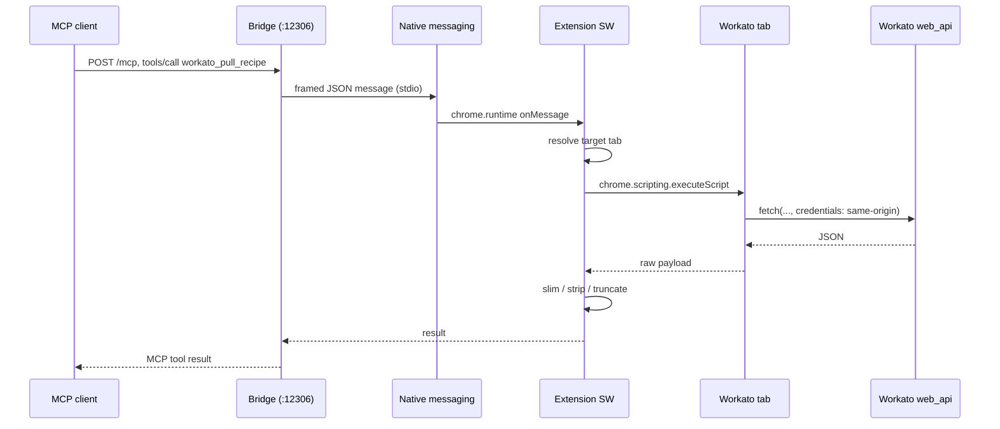

# Architecture

How a tool call travels from an MCP client to the browser and back.

## Components

| Component            | Package                                             | Role                                                                                                                                  |
| -------------------- | --------------------------------------------------- | ------------------------------------------------------------------------------------------------------------------------------------- |
| **Local bridge**     | `app/native-server` → npm `@mokuhub/mokutab-bridge` | Fastify server on `127.0.0.1:12306`. Terminates MCP transports, forwards tool calls to the extension, serves local file reads/writes. |
| **Chrome extension** | `app/chrome-extension` → npm-less, built with WXT   | MV3 service worker. Owns every tool handler, resolves the target tab, executes in-tab requests, slims responses.                      |
| **Shared schemas**   | `packages/shared` → npm `@mokuhub/mokutab-shared`   | Core tool names and schemas, each module's, and `TOOL_NAMES` / `TOOL_SCHEMAS` for the whole catalogue, consumed by both sides.        |
| **Recipe skill**     | `skills/workato-recipes`                            | Documentation-only companion for Workato recipe authoring. Not part of the runtime.                                                   |

## Core and modules

The code is split into a **core** (the browser tool: `chrome_*` tools, saved functions, watches, tab leases and strict mode, profile routing and the pin of profile + tab, `out_file` and auto-file, `chrome_fetch_to_file`, the four profile/bridge tools `chrome_list_profiles`, `chrome_switch_profile`, `chrome_bridge_info` and `chrome_reload_extension`) and **modules**. Workato is the first module. Each module has one folder per side:

```text
packages/shared/src/modules/workato/                           tool names, schemas, instructions snippet
app/native-server/src/modules/workato/                         bridge hooks and orchestrators
app/chrome-extension/entrypoints/background/modules/workato/   executors, afterCall hook, content-script gate
```

**Core never imports a module.** Each side has one wiring file, `modules/index.ts`, listing the installed modules, and core reaches them only through an interface. A boundary test on each side (`app/native-server/src/module-boundary.test.ts`, which also scans the shared package, and `app/chrome-extension/tests/module-boundary.test.ts`) fails when a file outside the module folders imports one, or one module imports another. The only exception is a WXT content-script entrypoint, which has to live at the top of `entrypoints/`; the extension test names which module each such file belongs to.

**Bridge side.** `BridgeModule` (`app/native-server/src/mcp/module-api.ts`): `tools`, `instructions`, `owns(name)`, `aliases`, and the hooks the router calls, in this order for a module tool:

0. **Aliases.** A module can keep old tool names working: Workato keeps `workato_list_profiles`, `workato_switch_profile`, `workato_bridge_info` and `workato_reload_extension` (the 1.x names of the four core tools) until 3.0. While the module is on, `tools/list` carries each alias after every other tool as a copy of its target's served schema, and the router swaps the name for the target's before anything else, so the pin, strict mode, leases and auto-file treat both names alike. While the module is off an alias is not listed, and a call is refused naming the new tool.
1. **Refusal.** A tool of a module that is switched off is refused before anything else, with the module name and "Turn it on in the MokuTab popup (Modules)", never "Tool not found".
2. **`session`.** Core pins profile + tab. A module adds pin fields on top (Workato: host, workspace and environment, read with `workato_session_context`): `probe` when `chrome_switch_profile` pins a tab, `summary` and `describe` for the reply, `targets` + `inject` to put the pinned tab and `expected_context` on each of its calls, `needsRecheck` + `recheck` after the profile registry changed (`ContextChanged`), `isContextChanging` + `follow` for `workato_switch_environment`. The router stores each module's pin under its id and never reads it.
3. **`prepare`.** File params in before the extension call, and an optional `finish` that replaces the result path on success (recipe `out_file` / `code_path`, LCAP `content_path` / `out_file`). Nested orchestrator calls get the same.
4. **`autoFile`.** The module's read tools (spill by default, advertised in the served schema) and the tools that accept an explicit `out_file`; the router combines them with the core rules.
5. **`handle`.** Bridge-side tools: pure helpers (`workato_datapill`) and orchestrators that drive several extension calls through `ModuleCallContext.callExtension` (the same pin, file params and routing profile as a top-level call).

**Extension side.** `ExtensionModule` (`entrypoints/background/extension-module.ts`): `executors` and an optional `afterCall(name, args, result)`. Workato's `afterCall` appends the `{"context":...}` block to every Workato result. The context block itself is a core convention: the bridge stamps the routed profile into whatever block a module appended, and auto-file keeps it out of spilled files.

**The module switch.** One switch per machine, kept in the bridge, in `~/.mokutab/config.json` (`{"modules": {"workato": true}}`, path from `data-dir.ts`). A module the file does not mention is off (`DEFAULT_ENABLED` in `mcp/module-switch.ts`). The first 2.x start writes an explicit value for each module once (`recordModuleDefaults`, called from `startup-migration.ts`): off on a fresh install, on when the machine ran 1.x, and never over an explicit value. The extension's own default (`common/module-state.ts`) stays on: only a bridge from before the switch never pushes a state, and that bridge serves every tool. A malformed file keeps the last good state (or the default) and says so in the log, and a read that fails for a moment is retried on the next look (at most every 250 ms). A popup change writes through a per-process temp file and a rename, so two profiles switching at once cannot interleave their writes. `tools/list` returns core plus the modules that are on; the server instructions are the core snippet, each enabled module's snippet and one line naming the modules that are off. On a change the bridge sends `notifications/tools/list_changed` to every open MCP session (servers declare `tools.listChanged` and join the registry once their client has initialized; the stdio proxy reads the same file every 2 s and forwards it). The extension popup's **Modules** section reads and writes the switch: popup → background message (`get_modules` / `set_module`) → `modules_get` / `modules_set` over the profile's WebSocket → bridge. The bridge pushes `modules_state` to every connected profile on connect and on each change; the background keeps it in `chrome.storage.local` (cleared when a bridge socket opens, so a bridge without the switch never inherits a stale "off"), refuses a switched-off module's tools too, and the Workato content script (`workato-field-outline`) does nothing while the module is off. With no bridge connected the switches are disabled. The background's side of this is `bridge-requests.ts` (requests, 5 s timeout) and `module-popup.ts` (the popup's handlers).

**Adding a module.** A folder per side next to `workato/`, one line in each `modules/index.ts`, and its shared descriptor in `packages/shared/src/modules/index.ts` (`MODULES`). The extension module carries its own one-line `description` for the popup.

**Tool lists in core.** Core code never reads the shared aggregates (`TOOL_SCHEMAS`, `TOOL_NAMES`, `MODULES`, the `WORKATO_*` exports); the bridge boundary test refuses those imports. A core list of tools comes from `app/native-server/src/mcp/catalogue.ts`: the core schemas plus the installed modules, through the registry.

## Request lifecycle

A Workato call, which takes the longest path (a core browser tool skips the Workato tab and its `web_api`, and runs against the page or the Chrome APIs instead):



1. **Transport.** The bridge exposes streamable HTTP at `POST/GET/DELETE /mcp`, legacy SSE at `GET /sse` + `POST /messages`, and a stdio binary (`mokutab-stdio`) for clients that require a spawned process. `GET /ping` is a liveness check.
2. **Bootstrap.** The bridge is not started by hand. Chrome launches it through native messaging when the extension first needs it; the extension tells the host which port to listen on.
3. **Dispatch.** The native-messaging host frames requests over stdio (4-byte little-endian length prefix, 16 MB cap) and correlates responses by UUID.
4. **Execution.** Every Workato tool runs _inside a Workato tab_ via `chrome.scripting.executeScript`, so requests carry the session cookies and the CSRF token read from the `XSRF-TOKEN-V2` cookie. No credentials ever cross a process boundary.
5. **Slimming.** Handlers reshape Workato's verbose payloads before returning: schema blocks removed, datapill references shortened, long values truncated, secret-shaped keys stripped. `full: true` opts out where it makes sense.

## Tab resolution

`findWorkatoTab()` in [`workato/tab-dispatch.ts`](../app/chrome-extension/entrypoints/background/modules/workato/tools/workato/tab-dispatch.ts) is the single gatekeeper. It resolves, in order:

1. An explicit `tabId` argument
2. The tab pinned by `chrome_switch_profile`
3. A Workato tab in the requesting window
4. Any open Workato app tab

Deliberately **never** the focused tab: focus drift used to send Workato calls into unrelated pages. Hosts are matched against `*.workato.com` and `*.workato.is`, and non-app subdomains (docs, marketing, status) are ignored. Zero matches raise `TabNotFound`; two different app hosts raise `MultipleWorkatoHosts`. An explicit `tabId` that no longer resolves to a signed-in app tab throws rather than falling through to another tab, and `findWorkatoTab` takes an optional `windowId` so window-scoped resolution lives in the dispatcher rather than in one tool.

## Session context

A Workato call's identity is **profile plus tab**, because Workato resolves the workspace and the environment from the tab's own session. Nothing in a response used to say which one that was.

`session-context.ts` in the extension reads `/web_api/auth_user.json` and slims it to `{host, workspace_id, workspace_name, environment, user_id}`, cached per tab for 60 s and dropped on a URL change, a tab close or any read error. `workato_session_context` exposes it directly.

- **The context block.** Every successful `workato_*` result gets one extra text block, always LAST and under 200 bytes: `{"context":{tab_id, host, workspace_id, workspace_name, environment}}`, with the routed `profile` added by the bridge. Producing it can never fail a call. Every response parser in the bridge reads the FIRST block, so orchestrators are unaffected.
- **The pinned tuple.** `createToolRouter` holds one `SessionContext` (profile, tabId, pinned_at, registry generation, and each module's pin fields; Workato's are host, workspace_id, workspace_name, environment, in `src/modules/workato/session.ts`). `chrome_switch_profile` with a `tabId` probes that tab once and pins the whole tuple; every later Workato call, top-level and nested, carries the pinned tab and an `expected_context`.
- **Verification.** Write entry points call `assertExpectedContext` before acting and throw `ContextMismatch`, naming expected and actual. `ProfileRegistry` bumps a generation counter on connect and disconnect; when it moves, the pinned tab is re-read once and the call is refused with `ContextChanged` if the workspace or environment differ.
- **On disk.** `workato_pull_recipe(out_file)` writes an `origin` block into the envelope (pulled_at, profile, tab, host, workspace id and name, environment, folder). The save path turns it back into an expected context and defaults `expected_base_version_no` from the file's `version_no`. `ignore_file_version` and `allow_context_mismatch` are the deliberate overrides, consumed in the bridge and never forwarded to the extension.

## The guarded mutation engine

Every native recipe write runs through one file, `app/native-server/src/modules/workato/recipe-engine.ts`, in this order:

1. Pull once, `view: "full"`, forwarding `tabId` / `windowId`.
2. Refuse a stale caller-supplied `expected_base_version_no` before any operation runs; otherwise default it to the pulled `version_no`.
3. Deep-clone the tree and apply every operation to the CLONE.
4. Renumber the whole tree when structure changed.
5. Derive extended schemas over the whole tree (`recipe-schema.ts`) unless `auto_schema: false`.
6. Validate locally: numbering, `as` format and uniqueness, `uuid` presence, block ordering, `foreach` source placement, datapill references.
7. MERGE the pulled `config` rather than rebuilding it, so `account_id` and `skip_validation` survive and only a new provider is appended.
8. Save once through `workato_ui_save_recipe_code`, then summarize once with `persisted` / `valid` / `verified`, `changed_paths` and `version_no`.

`workato_recipe_apply` batches up to 50 operations through the same path. `workato_recipe_validate` reuses steps 1 to 6 and stops there; it never calls the save tool, which a test asserts.

**Where the legacy names live now.** `workato_recipe_add_step`, `workato_recipe_set_step_input` and `workato_recipe_map_datapill` were extension tools with their own CDP implementation. They are now thin wrappers over the engine's ops, routed in the bridge through `WORKATO_RECIPE_MUTATOR_TOOLS`, and `app/chrome-extension/entrypoints/background/tools/workato-recipe/` is deleted. There is one implementation rather than two that drift, and **the bridge and the extension must ship together** for this reason.

## The operations journal

`app/native-server/src/modules/workato/operations.ts` makes `workato_recipe_save_with_dependents` survive a client timeout or a bridge restart.

- **Location.** One JSON file per operation in the bridge state directory (`%LOCALAPPDATA%\mcp-chrome-bridge\operations` on Windows), with an `os.tmpdir()` fallback (`mokutab-operations`) and `MOKUTAB_OPERATIONS_DIR` for tests. Atomic tmp plus rename writes, pruned once per process at 200 files or 7 days.
- **Contents.** `operation_id`, `kind`, timestamps, context, the args WITHOUT the code tree (a `code_path` plus a sha256 prefix), every affected recipe with the running state and version it had BEFORE the operation, phases with timestamps and results, and an `interrupted` marker.
- **Phases.** The phase is written BEFORE the call it describes, so an interrupted call still leaves a trace. A process `exit` hook marks any still-running operation interrupted synchronously.
- **Resume.** `workato_operation_status` is bridge-local: the read path makes no extension call at all. `resume: true` re-reads every affected recipe, restarts only what was running before and only when the saved version is usable and connections are healthy, re-issues an unknown save under the journalled version lock (so Workato answers `already_applied`), and names exact ids and reasons for anything it will not finish. Nothing is restored blindly on a transport that just failed.

## The snapshot cache

A recipe read is two requests, and they used to be able to straddle a save. `pull-recipe.ts` fetches metadata first and then pins the code to that exact version (`code.json?mode=view&version_no=<n>`), and caches the pair in the service worker keyed by **tab host plus recipe plus version**, bounded at 32 entries and 20 MB.

A key that does not match the current version simply cannot be served, so a stale entry is structurally impossible; every extension write path also calls `invalidateRecipeSnapshot` so the memory is freed promptly. `loadRecipeSnapshot(tab, recipeId, {timeoutMs, ifVersion})` is how another tool reads a recipe without a second fetch: `workato_list_jobs` (report labels), `workato_test_recipe` and `workato_recipe_callers` all go through it.

## Auto-file post-processing

`app/native-server/src/mcp/auto-file.ts` gives the read surface one escape hatch instead of a per-tool one.

- **Rules, from core and modules.** Core knows its own read tools (`CORE_READ_TOOLS`: `chrome_snapshot`, `chrome_get_web_content`, `chrome_javascript`, `chrome_search_page`, `chrome_find_elements`) and `chrome_screenshot`, which is advertised but spills only when asked; a module brings its read tools and the tools that accept an explicit `out_file` through `BridgeModule.autoFile` (Workato: `WORKATO_READ_TOOLS` in `src/modules/workato/index.ts`, and every other Workato tool except the four that own their own hook). The router combines them.
- **Served-schema injection.** `withOutFileToolSchemas` adds `out_file`, `auto_file` and `auto_file_threshold_chars` to every read tool and to `chrome_screenshot` at `listTools` time, filling in only a property the tool does not already declare. Nothing changes in the shared schemas; adding a read tool is one line in its read-tool set.
- **Prepare, then apply.** `prepareAutoFileCall` extracts and strips the three arguments before the browser round trip (so a bad path fails early) and leaves alone the four tools that own their own `out_file` hook: `workato_pull_recipe`, `workato_lcap_page_get`, `workato_api_request`, `workato_adapter_meta`. `applyAutoFile` runs at the single success return, writing the full text or the decoded image bytes with a tmp plus rename write and returning a summary: `saved_to`, `bytes`, `content_type`, `version_no`, top-level keys, depth-1 array counts, and the payload's own truncation flags copied verbatim.
- **Not hooked.** The nested `callExtension` inside the orchestrators is deliberately left alone: spilling an orchestrator's own pull would hand it a summary instead of the payload. Bridge-local tools (`chrome_bridge_info`, `workato_recipe_apply`, `workato_recipe_validate`, `workato_operation_status`, `workato_datapill`) return before the post-processor and take none of these properties.

## Multi-profile support

Chrome runs one extension instance per profile, and each connects to the bridge over `GET /ws-client` carrying its profile name. `ProfileRegistry` keeps the socket map and the currently active profile; `chrome_list_profiles` enumerates it, `chrome_switch_profile` selects one for the rest of the session and can pin a specific tab id at the same time. The default profile for unpinned calls is sticky and persisted (`default-profile.json` in the bridge state dir).

This is what makes a single MCP client able to work across, say, a customer sandbox in one profile and production in another.

## Data and state directories

| What             | Where                                                                                                                                                                                                                                                      | Override                                                                     |
| ---------------- | ---------------------------------------------------------------------------------------------------------------------------------------------------------------------------------------------------------------------------------------------------------- | ---------------------------------------------------------------------------- |
| Data dir         | `~/.mokutab`: the function registry (`functions/`, a git repository) and `config.json` (the module switch)                                                                                                                                                 | `MOKUTAB_DATA_DIR`, `MOKUTAB_FN_DIR`                                         |
| Bridge state dir | `%LOCALAPPDATA%\mcp-chrome-bridge` on Windows, `~/Library/Logs/mcp-chrome-bridge` on macOS, `$XDG_STATE_HOME/mcp-chrome-bridge` (or `~/.local/state/mcp-chrome-bridge`) on Linux: the update flag, the default profile, watches, `fn-runs/`, `operations/` | `MOKUTAB_UPDATE_STATE_DIR`, `MOKUTAB_FN_STATE_DIR`, `MOKUTAB_OPERATIONS_DIR` |
| Wrapper logs     | `%LOCALAPPDATA%\mokutab-bridge\logs` on Windows, `~/Library/Logs/mokutab-bridge` on macOS, `$XDG_STATE_HOME/mokutab-bridge/logs` (or `~/.local/state/mokutab-bridge/logs`) on Linux                                                                        | none                                                                         |
| Temp             | `<tmpdir>/mokutab-results` (auto-file spills), `<tmpdir>/mokutab-operations` (journal fallback)                                                                                                                                                            | none                                                                         |

The state dir keeps its 1.x name on purpose: everything in it stays where an upgrade in place finds it. Each of these overrides is read as `MOKUTAB_<NAME>` first and falls back to the name it replaced in 1.x until 3.0 (`env.ts`; `apply-update.cjs` mirrors it).

**The data dir move.** 1.x kept the data dir in `~/.workatomcp`. `index.ts` runs `migrateOnStart` (`startup-migration.ts`) before anything reads the data: it renames `~/.workatomcp` to `~/.mokutab` when only the old one exists, one rename on one volume, so the registry and the config move whole or not at all. It never copies, never deletes and never throws. When the rename fails (an open handle on Windows), that run keeps using `~/.workatomcp`, logs to stderr and records the failure in the state dir (`data-dir-move-failed.json`) for `doctor`; the next start tries again. Until the move has happened, every process resolves the old directory (`dataDir()` in `data-dir.ts`), so none sees half of the data; with both present, `~/.mokutab` wins. An override is used as is and never moved. The function registry asks `dataDir()` on every use, so a bridge that started before another process moved the directory follows the move.

**Fresh install or upgrade.** The same start decides once whether the machine ran 1.x: the old data dir, or the bridge state dir, exists. It looks before the process writes anything to the state dir (2.x keeps its own state there too) and records the answer as explicit module values in `config.json`, so a fresh install does not look like an upgrade at its second start. A machine that had the upstream `mcp-chrome-bridge` shares that state dir and counts as an upgrade; one popup switch turns Workato off.

**The registry identity.** `chrome_fn_save` commits as `mokutab <mokutab@localhost>`. The vault gate (`handCommitted`) lets a function read the vault only when a person made its last commit, and it counts both `mokutab` and the 1.x `workatomcp` identity as the machine, by name or email, as author or committer, so a function saved by 1.x never looks hand-committed.

## File round-trip

Large payloads bypass the model's context entirely. The bridge exposes local file read/write to the extension, so:

- `workato_pull_recipe(out_file: "recipe.json")` writes the code tree to disk and returns a path plus summary.
- `workato_ui_save_recipe_code(code_path: "recipe.json")` reads it back and PUTs it.
- `workato_recipe_set_py_eval_code(code_path: "parser.py")` splices a Python file into a step.
- `workato_lookup_table_import_csv(csv_path: "rows.csv")` streams a CSV into a multipart upload.

Recipes above roughly 50 KB should always use this path.

## Timeouts, retries, and write verification

| Layer              | Limit                                                                    |
| ------------------ | ------------------------------------------------------------------------ |
| MCP client         | typically cuts off around 60 s                                           |
| Bridge → extension | 120 s ceiling                                                            |
| Tool default       | 30 s (40 s for version diffs), configurable 10 to 110 s via `timeout_ms` |

Reads retry once automatically on a 30 s timeout and report `retried: true`; long-running calls such as `run_query` are excluded so the bridge ceiling isn't blown. Paginating reads (`list_jobs`) budget their page walk from `timeout_ms` and return partial results with `partial: true`, `scanned_through`, and `next_cursor` rather than dying mid-walk.

**Writes are never blindly retried.** A timed-out write verifies itself instead: stop/start re-read the recipe state, `set_version_comment` re-reads the versions list, `save_recipe_code` compares `version_no`. The result is reported as `save_status: "succeeded_after_timeout"` instead of a false failure.

Recipe saves accept `expected_base_version_no` for optimistic locking, so a concurrent edit fails loudly rather than being silently overwritten.

## Code layout

```text
packages/shared/src/
├── tools.ts                       # CORE_TOOL_NAMES, CORE_TOOL_SCHEMAS
├── module.ts                      # ToolModule, the switched-off refusal text
└── modules/
    ├── index.ts                   # MODULES, TOOL_NAMES, TOOL_SCHEMAS (whole catalogue)
    └── workato/                   # Workato tool names, schemas, instructions snippet

app/chrome-extension/entrypoints/background/
├── native-host.ts                 # bridge messages, module state push, popup relay
├── extension-module.ts            # ExtensionModule, the module state cache
├── tools/
│   ├── index.ts                   # dispatch: core executors + installed modules
│   └── browser/                   # browser automation
└── modules/
    ├── index.ts                   # EXTENSION_MODULES
    └── workato/
        ├── index.ts               # executors + afterCall (context block)
        ├── content-gate.ts        # content scripts run only while the module is on
        └── tools/
            ├── workato/           # recipes, jobs, connections, callers, folders, dispatch,
            │                      #   CSRF, session context, snapshot cache, slimming
            ├── workato-ui/        # live editor automation + save_recipe_code
            ├── workato-lookup/    # lookup tables
            ├── workato-lcap/      # Workflow App pages
            ├── workato-data-table/ # data tables
            └── workato-session/   # whoami

app/native-server/src/
├── server/index.ts                # Fastify routes, MCP transports
├── server/profile-registry.ts     # per-profile WebSocket connections, generation counter
├── server/module-sync.ts          # module switch over the extension connection
├── native-messaging-host.ts       # stdio framing to/from Chrome
├── file-handler.ts                # local file reads/writes for the round-trip
├── data-dir.ts                    # ~/.mokutab (function registry, config.json), the 1.x dir move
├── startup-migration.ts           # first-start move and the fresh-install-or-upgrade decision
├── env.ts                         # MOKUTAB_* overrides with the 1.x fallbacks
├── scripts/                       # register, doctor (with migration-checks.ts), report, watch-wait
├── mcp/                           # router, MCP server and stdio entrypoint, server identity,
│                                  #   module API and switch, auto-file, leases, watches,
│                                  #   browser functions
└── modules/
    ├── index.ts                   # INSTALLED_MODULES
    └── workato/                   # module hooks, the recipe mutation engine and validator,
                                   #   caller discovery, the operations journal, file IO
```

## Adding a tool

1. Declare it in the shared package: a core tool in `packages/shared/src/tools.ts` (`CORE_TOOL_NAMES`, `CORE_TOOL_SCHEMAS`), a Workato tool in `packages/shared/src/modules/workato/` (`tool-names.ts`, `schemas.ts`). Descriptions matter: they are the agent's only documentation at call time, so state the prerequisites, the gotchas, and what the response looks like.
2. Implement the handler: a core tool under `entrypoints/background/tools/browser/`, a Workato tool in the matching `modules/workato/tools/workato*` directory, exported from that directory's `index.ts`. A bridge-side Workato tool goes through the module's `handle` hook.
3. `pnpm build:shared && pnpm build:extension`, then `chrome_reload_extension` (or reload the unpacked extension by hand); restart the MCP client if it does not pick up the new schema.

Two constraints worth knowing before writing in-tab code:

- **In-page functions must be plain, bundler-safe JavaScript.** `chrome.scripting.executeScript` serializes the function, so use `function () { ... .then(...) }` rather than `async`/`await`, which the bundler rewrites into helpers that don't survive serialization.
- **Read the Workato CSRF token from the `XSRF-TOKEN-V2` cookie**, not from a `<meta>` tag: editor pages don't have one.

## Origin

MokuTab started as a fork of [hangwin/mcp-chrome](https://github.com/hangwin/mcp-chrome) and keeps its extension shell, native-messaging bridge, MCP transport handling, and browser-automation tools. It is developed independently and does not track upstream changes. The upstream features this project never used are gone: record-replay (recorded flows and the `flow.*` tools), the userscript manager and its options page, the element marker, the unlisted `chrome_inject_script`, `chrome_userscript` and `chrome_get_interactive_elements` tools, and the agent chat themes. On top of that base it adds the module system, the multi-profile registry, tab leases, watches, browser functions, the file round-trip, the Workato module with its tab resolution, session model, write verification and safety gates, and publishes its own packages, `@mokuhub/mokutab-bridge` and `@mokuhub/mokutab-shared`.

Historical design specs and implementation plans live in [`docs/design/`](design/).
